<h3><code>fahad@github ~ $ ./contributions.sh</code></h3>

  

<h3><code>fahad@github ~ $ whoami</code></h3>
<table>
<tr>
<td valign="top"></td>
<td valign="top"></td>
</tr>
</table>

  

<h3><code>fahad@github ~ $ ./links.sh</code></h3>

<b>Full-stack Developer</b>

<a href="https://github.com/fahadarshadbhatti-cloud">GitHub</a>

